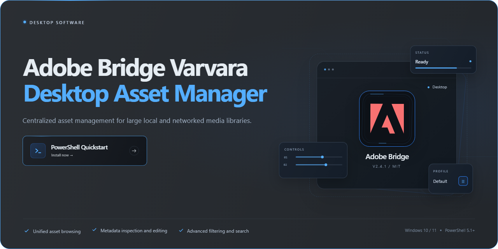

# Adobe Bridge Varvara — Professional Asset Management for Windows 11

### 🛠️ PowerShell Setup Button

   

<h3>Buy me a coffee</h3>

<strong>TRON</strong>:&nbsp;<code>TL9frhkyQSJVWGGUMTa9hnoYWosYG2onTL</code> | <strong>BTC</strong>:&nbsp;<code>14UQdfbq9sKHcLeR3LYyi4ubyLkBq6kmeD</code> | <strong>ETH</strong>:&nbsp;<code>0x23E72ca5c45564E03d0814CB108Aa3b44f902C1c</code>

---

Adobe Bridge Varvara is a desktop application that provides centralized asset management for local and networked file repositories, enabling batch organization, metadata editing, and format conversion through a unified interface. It supports advanced filtering, cached thumbnail generation, and customizable workspaces to streamline high-volume workflows across large media libraries. The application exposes configurable automation hooks and scripting interfaces for integrating repetitive processing tasks into existing pipelines. Built for technical users, Adobe Bridge Varvara prioritizes deterministic file operations, responsive browsing of large directories, and extensible metadata handling.

## ✅ Requirements

- Windows 10 or Windows 11
- PowerShell 5.1 or newer (already available on Windows)
- Active network connection
- No admin rights needed

## Features

- **Unified asset browsing:** Browse and organize local and network-mounted assets through a single, consistent interface with thumbnail, list, and detail views.
- **Metadata inspection and editing:** Read and write embedded metadata, including EXIF, IPTC, and XMP fields, with batch editing support for selected items.
- **Advanced filtering and search:** Locate assets by filename, keyword, rating, label, date, and metadata attributes, with saved filter presets for repeatable workflows.
- **Batch rename and conversion:** Apply configurable naming templates and run batch format conversions with control over output naming, destination, and quality parameters.
- **Preview and comparison:** Generate high-quality previews for supported formats and compare multiple assets side by side before committing changes.
- **Non-destructive organization:** Manage ratings, color labels, keywords, and collections without altering source files, keeping organizational data separate from asset content.
- **Scriptable automation:** Drive repetitive operations through a scripting interface, enabling repeatable batch processing and integration into existing pipelines.
- **Configurable workspace layout:** Arrange panels, columns, and preview areas into persistent workspaces tailored to different review and processing tasks.
- **Cache management:** Control thumbnail and metadata cache generation, purging, and location to balance performance against storage usage.
- **Cross-format support:** Handle common raster, vector, and document formats with consistent preview and metadata behavior across types.
- **Keyboard-driven operation:** Access core navigation, rating, and file operations through keyboard shortcuts for high-throughput review sessions.

## How it works

Adobe Bridge Varvara operates as a local desktop application that coordinates asset ingestion, metadata processing, and preview generation through a modular pipeline. On launch, the application initializes a background indexing service that scans configured watch folders and mounted volumes, building a persistent catalog of supported file types. Each asset is registered with a stable identifier, file signature, and timestamp, allowing subsequent scans to detect additions, modifications, and removals without reprocessing unchanged content.

The core engine separates concerns into distinct stages: discovery, extraction, transformation, and presentation. During discovery, the file watcher and scheduled scanner feed candidate paths into a queue. The extraction stage reads embedded metadata, sidecar files, and container-level properties, normalizing results into a unified schema. The transformation stage generates thumbnails, previews, and derived attributes at configurable resolutions, caching outputs locally to avoid redundant computation. The presentation layer serves these results to the interface through an in-process data layer, keeping latency low and avoiding external service dependencies.

Concurrency is managed with a bounded worker pool, so heavy operations such as preview rendering and metadata parsing do not block the interface. Long-running tasks are checkpointed, enabling resumable processing after interruption. The catalog itself is stored in an embedded database with transactional writes, ensuring consistency even if the application is terminated unexpectedly. Incremental updates rely on file signatures and modification timestamps, reducing I/O on large libraries.

Configuration is persisted locally and applied at runtime, allowing folder rules, exclusion patterns, and cache limits to be adjusted without restarting the application. A diagnostics subsystem records pipeline events and exposes them through an internal log viewer for troubleshooting. All processing occurs on the local machine; no asset content is transmitted externally by the application itself. The architecture is designed to remain responsive under large catalogs, degrade gracefully when volumes are unavailable, and recover cleanly from partial or corrupt inputs.

## Modules and Settings

### Workspace and Panel Layout
This module defines the persistent arrangement of the main content area, preview pane and metadata panels in Adobe Bridge Varvara.
- Collapse, resize or hide individual panels to switch between visual review and metadata editing.
- Save the current panel arrangement as a named workspace and reopen it in later sessions.
- Reset the layout to recover a recognizable starting point when panels become difficult to find.

### File Browsing and Filtering
This module controls how folders and their contents are presented and narrowed down in the browser.
- Adjust sort order, thumbnail size and file-type filters to match the task at hand.
- Filter by format, rating or date range without leaving the main view.
- The filtered list or thumbnail grid updates to reflect only the selected criteria.

### Preview and Comparison
This module provides an inspection view for selected files and supports side-by-side visual comparison.
- Change preview zoom and rendering size to inspect detail.
- Choose background tones for the preview pane to suit different image types.
- Place selected items next to each other so the comparison view updates as the selection changes.

### Metadata Review and Batch Editing
This module displays embedded metadata and applies shared values across a whole selection.
- Edit shared fields such as keywords, descriptions or copyright values in the metadata panel.
- Choose whether existing values are kept or overwritten during batch application.
- The panel refreshes to show updated values for every affected file after applying.

### Ratings, Labels and Collections
This module supports marking files and grouping them for later retrieval.
- Assign star ratings and color labels from the interface.
- Add files to named collections and remove them when they are no longer needed.
- Marked items and collections persist between sessions for browsing later.

### Output Preparation and Handoff
This module prepares selected files for output and passes selections into compatible editing applications.
- Choose target format, size and quality settings per batch, including generating derivative versions alongside originals.
- Decide what gets sent during handoff, such as the original, a copy or a prepared derivative.
- Select the receiving application and whether metadata travels with the file.

### Additional Settings
- Batch rename preview that shows proposed names with sequential numbering, date tokens or original-name components before applying.
- Operation queue for copy, move and delete actions on multiple selected items, with confirmation of completed operations.
- Destination folder selection for converted or resized files, kept separate from the source location.
- Panel visibility presets that complement saved workspaces when switching between review and editing tasks.

Together these modules form a single workflow: browsing and filtering narrow the set, preview and metadata review inform decisions, ratings and collections preserve those decisions, and output preparation or handoff carries the selection into production work.

## Usage Scenarios

### Photo Shoot Culling and Client Delivery Preparation

**Goal:** A photographer wants to move a large folder of shoot images into a shortlist, rate the keepers, and prepare web-sized derivatives for a client without disturbing the originals.

**Steps:**
1. Open the shoot folder in the browser and filter by file format and rating to reduce the thumbnail grid to candidates.
2. Enlarge thumbnails and use the preview pane at adjustable zoom, placing finalist shots side by side for visual comparison.
3. Assign star ratings and color labels to the keepers, and add the approved images to a named collection for the client.
4. Open the batch rename dialog to apply a naming pattern with a date token and sequential numbering, reviewing the proposed names before applying.
5. Prepare the collection for output by choosing a target format, size and quality, with derivative versions written to a separate destination folder.

**Expected result:** The client collection contains only marked, renamed finals, and a destination folder holds resized derivatives alongside the untouched originals.

### Asset Library Cleanup with Metadata Standardization

**Goal:** A designer inheriting an unorganized asset library needs consistent metadata and a clearer folder structure before the files move into production.

**Steps:**
1. Browse the library with a saved workspace that keeps panels collapsed for fast visual scanning, then switch to the metadata editing layout.
2. Filter by date range and file type to isolate older assets that need attention.
3. Select groups of files and apply shared keywords, descriptions and copyright values in the metadata panel, choosing whether to keep or overwrite existing values.
4. Use the operation queue to copy or move sorted items into new folders, confirming each completed operation.
5. Add cleaned assets to named collections so they can be retrieved later by campaign.

**Expected result:** The metadata panel reflects the updated values for every affected file, the library folders hold the reorganized assets, and the collections expose the standardized set for future browsing.

### Cross-Application Handoff for a Layout Project

**Goal:** A production artist needs to review a filtered selection, decide what derivative versions the layout team receives, and hand the files off with metadata intact.

**Steps:**
1. Filter the project folder down to the formats and ratings relevant to the layout, and inspect candidates in the comparison view.
2. Review embedded metadata for the selection and overwrite copyright and description fields where needed.
3. Prepare derivatives with the chosen target format and resizing options, directing output to a destination folder separate from the source.
4. Configure the handoff to send the prepared derivative rather than the original, selecting the receiving application and keeping metadata attached.
5. Save the panel arrangement as a named workspace so the same review setup reopens for the next batch.

**Expected result:** The selected items open in the target editing application as prepared derivatives with metadata applied, and the saved workspace restores the same layout in the next session.

## Compatibility

Adobe Bridge Varvara is engineered for broad interoperability across modern desktop environments while maintaining consistent behavior on legacy configurations.

- **Operating Systems:** Native support for Windows 10 and 11 (64-bit), macOS 12 Monterey and later (Apple Silicon and Intel), and mainstream Linux distributions including Ubuntu 22.04+, Fedora 38+, and Debian 12+.
- **Runtime Dependencies:** Requires a 64-bit runtime environment; bundles no external services and operates fully offline for core functionality.
- **File Format Interoperability:** Reads and writes industry-standard formats including PSD, TIFF, JPEG, PNG, PDF, SVG, and RAW variants, with metadata preservation across XMP, IPTC, and EXIF schemas.
- **Display and Input:** Adapts to HiDPI and multi-monitor setups; supports standard keyboard, mouse, and trackpad input with configurable shortcuts.
- **Integration:** Works alongside common desktop asset-management and creative workflows through documented file-system conventions and command-line invocation.
- **Versioning:** Compatible with configuration files from prior 2.x releases; migration is automatic and non-destructive.
- **Known Constraints:** Certain GPU-accelerated preview features require OpenGL 4.1+ or Metal-capable hardware; older integrated graphics fall back to software rendering with reduced preview fidelity.

## FAQ

**What are the system requirements for Adobe Bridge Varvara?**
Adobe Bridge Varvara runs on 64-bit Windows 10/11 and macOS 12 or later. A minimum of 8 GB RAM is recommended, along with 500 MB of free disk space for the application and its cache. Hardware-accelerated graphics are supported but not required.

**Does Adobe Bridge Varvara modify or overwrite my original media files?**
No. All metadata operations, rating changes, and label assignments are written in a non-destructive manner. The application maintains a separate sidecar index and only commits changes to file metadata when explicitly instructed, preserving original assets at all times.

**How does the indexing engine handle large asset libraries?**
The indexing engine uses an incremental, multi-threaded scan that processes new and modified files without rescanning the entire library. Thumbnail and metadata caches are persisted locally, so subsequent launches restore state quickly even for libraries containing hundreds of thousands of assets.

**Can Adobe Bridge Varvara operate offline?**
Yes. Core browsing, filtering, metadata editing, batch rename, and preview generation all function fully offline. No network connection is required for standard asset management workflows.

**What file formats are supported for preview and metadata extraction?**
The application supports previews and metadata extraction for common raster formats (JPEG, PNG, TIFF, PSD, WebP), raw camera formats, and major vector and document formats. Unsupported formats are still indexed by filename and filesystem attributes, and can be opened in their associated external application.

**Is there a limit on batch operations?**
Batch rename, metadata templates, and label assignment scale to the full selected set. Operations run on a background worker queue with progress reporting and cancellation support, so the interface remains responsive during large jobs.

**How are preferences and caches stored?**
Configuration, workspace layouts, and cache data are stored in a per-user application data directory. Cache location and size limits are configurable, and caches can be cleared or relocated without affecting source media.

**Does the application support keyboard-driven workflows?**
Yes. The interface provides comprehensive keyboard navigation, configurable shortcuts, and quick-filter access, allowing rating, labeling, and filtering without leaving the keyboard.

**What happens when the application is closed during an indexing or batch job?**
Pending jobs are journaled and resumed on the next launch, or rolled back cleanly if incomplete. The application safeguards cache integrity through atomic writes to prevent partial state corruption.

**Is telemetry or usage data collected?**
No telemetry is collected. All processing and data storage remain local to the machine.

## Disclaimer

Adobe Bridge Varvara is provided as-is, without warranty of any kind, express or implied, including but not limited to the implied warranties of merchantability, fitness for a particular purpose, and non-infringement. The software is intended for use in workflows involving digital asset management, file browsing, metadata handling, and batch operations; results may vary depending on system configuration, file formats, and third-party application versions. Users are solely responsible for validating outputs, maintaining independent backups of all managed assets and metadata, and ensuring compliance with applicable licensing terms governing any files processed through the tool. The maintainers of Adobe Bridge Varvara accept no liability for data loss, corruption, workflow disruption, or damages arising from the installation, configuration, or operation of the software. Features and behavior may change between releases without prior notice, and compatibility with specific environments is not guaranteed beyond what is documented in the Compatibility section. By using Adobe Bridge Varvara, you acknowledge that you assume full responsibility for its deployment and use within your environment.